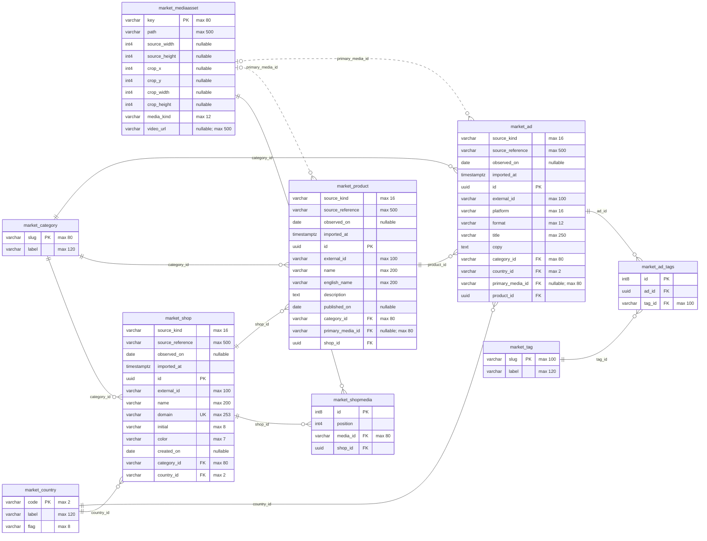
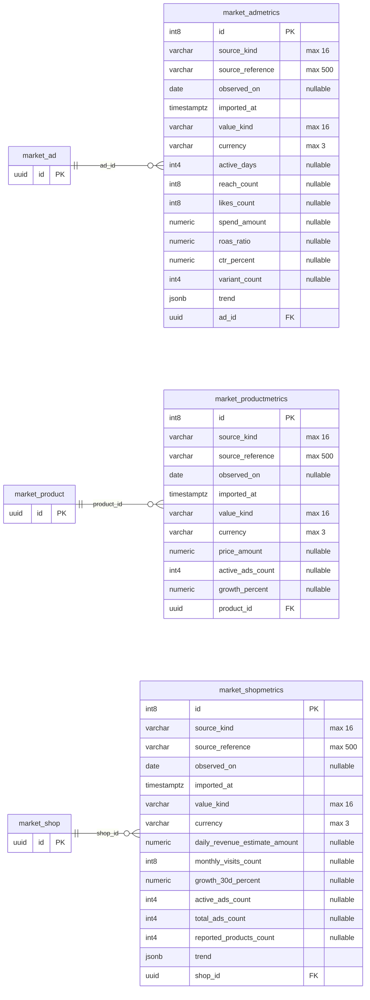
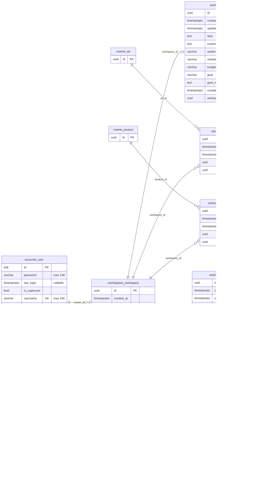

# Actual database schema

Generated from the migrated local PostgreSQL database; no business rows or credentials are exported.

The diagrams show physical tables, columns, keys and nullable foreign keys. External-context tables appear with their primary key only; their full columns are listed below.

Demo data: 6 shops, 8 products, 10 ads and 9 image assets. Ad shop ownership is derived through Product, preventing mismatched Ad/Product/Shop references. Metrics are snapshots; reported counts are separate from actual demo-record counts. Currency is USD. Unknown observation dates are null; trends are undated ordinal indices.

Workspace ownership protects briefs, bookmarks, watches and report definitions. accounts_user.password stores Django password hashes. Django's additional auth/session/admin tables are framework-managed.

## Catalog



## Metrics



## Workspaces



## All application columns and database constraints

Composite UNIQUE constraints appear under each table; individual columns are marked UK only when individually unique.

### accounts_user

| Column | PostgreSQL type | Nullable | Keys | References |
| --- | --- | --- | --- | --- |
| id | int8 | no | PK |  |
| password | varchar(128) | no |  |  |
| last_login | timestamptz | yes |  |  |
| is_superuser | bool | no |  |  |
| username | varchar(150) | no | UK |  |
| first_name | varchar(150) | no |  |  |
| last_name | varchar(150) | no |  |  |
| email | varchar(254) | no |  |  |
| is_staff | bool | no |  |  |
| is_active | bool | no |  |  |
| date_joined | timestamptz | no |  |  |

```sql
accounts_user_pkey: PRIMARY KEY (id)
accounts_user_username_key: UNIQUE (username)
```

### accounts_user_groups

| Column | PostgreSQL type | Nullable | Keys | References |
| --- | --- | --- | --- | --- |
| id | int8 | no | PK |  |
| user_id | int8 | no | FK | accounts_user.id |
| group_id | int4 | no | FK | auth_group.id |

```sql
accounts_user_groups_group_id_bd11a704_fk_auth_group_id: FOREIGN KEY (group_id) REFERENCES auth_group(id) DEFERRABLE INITIALLY DEFERRED
accounts_user_groups_pkey: PRIMARY KEY (id)
accounts_user_groups_user_id_52b62117_fk_accounts_user_id: FOREIGN KEY (user_id) REFERENCES accounts_user(id) DEFERRABLE INITIALLY DEFERRED
accounts_user_groups_user_id_group_id_59c0b32f_uniq: UNIQUE (user_id, group_id)
```

### accounts_user_user_permissions

| Column | PostgreSQL type | Nullable | Keys | References |
| --- | --- | --- | --- | --- |
| id | int8 | no | PK |  |
| user_id | int8 | no | FK | accounts_user.id |
| permission_id | int4 | no | FK | auth_permission.id |

```sql
accounts_user_user_p_permission_id_113bb443_fk_auth_perm: FOREIGN KEY (permission_id) REFERENCES auth_permission(id) DEFERRABLE INITIALLY DEFERRED
accounts_user_user_p_user_id_e4f0a161_fk_accounts_: FOREIGN KEY (user_id) REFERENCES accounts_user(id) DEFERRABLE INITIALLY DEFERRED
accounts_user_user_permi_user_id_permission_id_2ab516c2_uniq: UNIQUE (user_id, permission_id)
accounts_user_user_permissions_pkey: PRIMARY KEY (id)
```

### market_ad

| Column | PostgreSQL type | Nullable | Keys | References |
| --- | --- | --- | --- | --- |
| source_kind | varchar(16) | no |  |  |
| source_reference | varchar(500) | no |  |  |
| observed_on | date | yes |  |  |
| imported_at | timestamptz | no |  |  |
| id | uuid | no | PK |  |
| external_id | varchar(100) | no |  |  |
| platform | varchar(16) | no |  |  |
| format | varchar(12) | no |  |  |
| title | varchar(250) | no |  |  |
| copy | text | no |  |  |
| category_id | varchar(80) | no | FK | market_category.slug |
| country_id | varchar(2) | no | FK | market_country.code |
| primary_media_id | varchar(80) | yes | FK | market_mediaasset.key |
| product_id | uuid | no | FK | market_product.id |

```sql
market_ad_category_id_ac8a339e_fk_market_category_slug: FOREIGN KEY (category_id) REFERENCES market_category(slug) DEFERRABLE INITIALLY DEFERRED
market_ad_country_id_3675014d_fk_market_country_code: FOREIGN KEY (country_id) REFERENCES market_country(code) DEFERRABLE INITIALLY DEFERRED
market_ad_format_valid: CHECK (((format)::text = ANY ((ARRAY['image'::character varying, 'video'::character varying])::text[])))
market_ad_pkey: PRIMARY KEY (id)
market_ad_platform_valid: CHECK (((platform)::text = ANY ((ARRAY['meta'::character varying, 'tiktok'::character varying, 'youtube'::character varying])::text[])))
market_ad_primary_media_id_3f0b234d_fk_market_mediaasset_key: FOREIGN KEY (primary_media_id) REFERENCES market_mediaasset(key) DEFERRABLE INITIALLY DEFERRED
market_ad_product_id_2b00c162_fk_market_product_id: FOREIGN KEY (product_id) REFERENCES market_product(id) DEFERRABLE INITIALLY DEFERRED
market_ad_source_external_unique: UNIQUE (source_kind, external_id)
```

### market_ad_tags

| Column | PostgreSQL type | Nullable | Keys | References |
| --- | --- | --- | --- | --- |
| id | int8 | no | PK |  |
| ad_id | uuid | no | FK | market_ad.id |
| tag_id | varchar(100) | no | FK | market_tag.slug |

```sql
market_ad_tags_ad_id_eb1a3402_fk_market_ad_id: FOREIGN KEY (ad_id) REFERENCES market_ad(id) DEFERRABLE INITIALLY DEFERRED
market_ad_tags_ad_id_tag_id_1dcfd634_uniq: UNIQUE (ad_id, tag_id)
market_ad_tags_pkey: PRIMARY KEY (id)
market_ad_tags_tag_id_74b476a4_fk_market_tag_slug: FOREIGN KEY (tag_id) REFERENCES market_tag(slug) DEFERRABLE INITIALLY DEFERRED
```

### market_admetrics

| Column | PostgreSQL type | Nullable | Keys | References |
| --- | --- | --- | --- | --- |
| id | int8 | no | PK |  |
| source_kind | varchar(16) | no |  |  |
| source_reference | varchar(500) | no |  |  |
| observed_on | date | yes |  |  |
| imported_at | timestamptz | no |  |  |
| value_kind | varchar(16) | no |  |  |
| currency | varchar(3) | no |  |  |
| active_days | int4 | yes |  |  |
| reach_count | int8 | yes |  |  |
| likes_count | int8 | yes |  |  |
| spend_amount | numeric | yes |  |  |
| roas_ratio | numeric | yes |  |  |
| ctr_percent | numeric | yes |  |  |
| variant_count | int4 | yes |  |  |
| trend | jsonb | no |  |  |
| ad_id | uuid | no | FK | market_ad.id |

```sql
market_ad_ctr_range: CHECK (((ctr_percent >= (0)::numeric) AND (ctr_percent <= (100)::numeric)))
market_ad_metrics_source_unique: UNIQUE (ad_id, source_kind, source_reference)
market_ad_roas_nonnegative: CHECK ((roas_ratio >= (0)::numeric))
market_ad_spend_nonnegative: CHECK ((spend_amount >= (0)::numeric))
market_admetrics_active_days_check: CHECK ((active_days >= 0))
market_admetrics_ad_id_9ce80f48_fk_market_ad_id: FOREIGN KEY (ad_id) REFERENCES market_ad(id) DEFERRABLE INITIALLY DEFERRED
market_admetrics_likes_count_check: CHECK ((likes_count >= 0))
market_admetrics_pkey: PRIMARY KEY (id)
market_admetrics_reach_count_check: CHECK ((reach_count >= 0))
market_admetrics_variant_count_check: CHECK ((variant_count >= 0))
```

### market_category

| Column | PostgreSQL type | Nullable | Keys | References |
| --- | --- | --- | --- | --- |
| slug | varchar(80) | no | PK |  |
| label | varchar(120) | no |  |  |

```sql
market_category_pkey: PRIMARY KEY (slug)
```

### market_country

| Column | PostgreSQL type | Nullable | Keys | References |
| --- | --- | --- | --- | --- |
| code | varchar(2) | no | PK |  |
| label | varchar(120) | no |  |  |
| flag | varchar(8) | no |  |  |

```sql
market_country_pkey: PRIMARY KEY (code)
```

### market_mediaasset

| Column | PostgreSQL type | Nullable | Keys | References |
| --- | --- | --- | --- | --- |
| key | varchar(80) | no | PK |  |
| path | varchar(500) | no |  |  |
| source_width | int4 | yes |  |  |
| source_height | int4 | yes |  |  |
| crop_x | int4 | yes |  |  |
| crop_y | int4 | yes |  |  |
| crop_width | int4 | yes |  |  |
| crop_height | int4 | yes |  |  |
| media_kind | varchar(12) | no |  |  |
| video_url | varchar(500) | yes |  |  |

```sql
market_mediaasset_crop_height_check: CHECK ((crop_height >= 0))
market_mediaasset_crop_width_check: CHECK ((crop_width >= 0))
market_mediaasset_crop_x_check: CHECK ((crop_x >= 0))
market_mediaasset_crop_y_check: CHECK ((crop_y >= 0))
market_mediaasset_pkey: PRIMARY KEY (key)
market_mediaasset_source_height_check: CHECK ((source_height >= 0))
market_mediaasset_source_width_check: CHECK ((source_width >= 0))
```

### market_product

| Column | PostgreSQL type | Nullable | Keys | References |
| --- | --- | --- | --- | --- |
| source_kind | varchar(16) | no |  |  |
| source_reference | varchar(500) | no |  |  |
| observed_on | date | yes |  |  |
| imported_at | timestamptz | no |  |  |
| id | uuid | no | PK |  |
| external_id | varchar(100) | no |  |  |
| name | varchar(200) | no |  |  |
| english_name | varchar(200) | no |  |  |
| description | text | no |  |  |
| published_on | date | yes |  |  |
| category_id | varchar(80) | no | FK | market_category.slug |
| primary_media_id | varchar(80) | yes | FK | market_mediaasset.key |
| shop_id | uuid | no | FK | market_shop.id |

```sql
market_product_category_id_68f368e0_fk_market_category_slug: FOREIGN KEY (category_id) REFERENCES market_category(slug) DEFERRABLE INITIALLY DEFERRED
market_product_pkey: PRIMARY KEY (id)
market_product_primary_media_id_70509d26_fk_market_me: FOREIGN KEY (primary_media_id) REFERENCES market_mediaasset(key) DEFERRABLE INITIALLY DEFERRED
market_product_shop_id_adbe482e_fk_market_shop_id: FOREIGN KEY (shop_id) REFERENCES market_shop(id) DEFERRABLE INITIALLY DEFERRED
market_product_source_external_unique: UNIQUE (source_kind, external_id)
```

### market_productmetrics

| Column | PostgreSQL type | Nullable | Keys | References |
| --- | --- | --- | --- | --- |
| id | int8 | no | PK |  |
| source_kind | varchar(16) | no |  |  |
| source_reference | varchar(500) | no |  |  |
| observed_on | date | yes |  |  |
| imported_at | timestamptz | no |  |  |
| value_kind | varchar(16) | no |  |  |
| currency | varchar(3) | no |  |  |
| price_amount | numeric | yes |  |  |
| active_ads_count | int4 | yes |  |  |
| growth_percent | numeric | yes |  |  |
| product_id | uuid | no | FK | market_product.id |

```sql
market_product_growth_minimum: CHECK ((growth_percent >= ('-100'::integer)::numeric))
market_product_metrics_source_unique: UNIQUE (product_id, source_kind, source_reference)
market_product_price_nonnegative: CHECK ((price_amount >= (0)::numeric))
market_productmetrics_active_ads_count_check: CHECK ((active_ads_count >= 0))
market_productmetrics_pkey: PRIMARY KEY (id)
market_productmetrics_product_id_2249fa8a_fk_market_product_id: FOREIGN KEY (product_id) REFERENCES market_product(id) DEFERRABLE INITIALLY DEFERRED
```

### market_shop

| Column | PostgreSQL type | Nullable | Keys | References |
| --- | --- | --- | --- | --- |
| source_kind | varchar(16) | no |  |  |
| source_reference | varchar(500) | no |  |  |
| observed_on | date | yes |  |  |
| imported_at | timestamptz | no |  |  |
| id | uuid | no | PK |  |
| external_id | varchar(100) | no |  |  |
| name | varchar(200) | no |  |  |
| domain | varchar(253) | no | UK |  |
| initial | varchar(8) | no |  |  |
| color | varchar(7) | no |  |  |
| created_on | date | yes |  |  |
| category_id | varchar(80) | no | FK | market_category.slug |
| country_id | varchar(2) | no | FK | market_country.code |

```sql
market_shop_category_id_13f3c043_fk_market_category_slug: FOREIGN KEY (category_id) REFERENCES market_category(slug) DEFERRABLE INITIALLY DEFERRED
market_shop_country_id_92d92f79_fk_market_country_code: FOREIGN KEY (country_id) REFERENCES market_country(code) DEFERRABLE INITIALLY DEFERRED
market_shop_domain_key: UNIQUE (domain)
market_shop_domain_normalized: CHECK ((((domain)::text = lower(TRIM(BOTH FROM domain))) AND (NOT ((domain)::text ~~ '%.'::text))))
market_shop_pkey: PRIMARY KEY (id)
market_shop_source_external_unique: UNIQUE (source_kind, external_id)
```

### market_shopmedia

| Column | PostgreSQL type | Nullable | Keys | References |
| --- | --- | --- | --- | --- |
| id | int8 | no | PK |  |
| position | int4 | no |  |  |
| media_id | varchar(80) | no | FK | market_mediaasset.key |
| shop_id | uuid | no | FK | market_shop.id |

```sql
market_shop_media_asset_unique: UNIQUE (shop_id, media_id)
market_shop_media_position_unique: UNIQUE (shop_id, "position")
market_shopmedia_media_id_8890e912_fk_market_mediaasset_key: FOREIGN KEY (media_id) REFERENCES market_mediaasset(key) DEFERRABLE INITIALLY DEFERRED
market_shopmedia_pkey: PRIMARY KEY (id)
market_shopmedia_position_check: CHECK (("position" >= 0))
market_shopmedia_shop_id_07cbdbb6_fk_market_shop_id: FOREIGN KEY (shop_id) REFERENCES market_shop(id) DEFERRABLE INITIALLY DEFERRED
```

### market_shopmetrics

| Column | PostgreSQL type | Nullable | Keys | References |
| --- | --- | --- | --- | --- |
| id | int8 | no | PK |  |
| source_kind | varchar(16) | no |  |  |
| source_reference | varchar(500) | no |  |  |
| observed_on | date | yes |  |  |
| imported_at | timestamptz | no |  |  |
| value_kind | varchar(16) | no |  |  |
| currency | varchar(3) | no |  |  |
| daily_revenue_estimate_amount | numeric | yes |  |  |
| monthly_visits_count | int8 | yes |  |  |
| growth_30d_percent | numeric | yes |  |  |
| active_ads_count | int4 | yes |  |  |
| total_ads_count | int4 | yes |  |  |
| reported_products_count | int4 | yes |  |  |
| trend | jsonb | no |  |  |
| shop_id | uuid | no | FK | market_shop.id |

```sql
market_shop_growth_minimum: CHECK ((growth_30d_percent >= ('-100'::integer)::numeric))
market_shop_metrics_source_unique: UNIQUE (shop_id, source_kind, source_reference)
market_shop_revenue_nonnegative: CHECK ((daily_revenue_estimate_amount >= (0)::numeric))
market_shopmetrics_active_ads_count_check: CHECK ((active_ads_count >= 0))
market_shopmetrics_monthly_visits_count_check: CHECK ((monthly_visits_count >= 0))
market_shopmetrics_pkey: PRIMARY KEY (id)
market_shopmetrics_reported_products_count_check: CHECK ((reported_products_count >= 0))
market_shopmetrics_shop_id_1427c927_fk_market_shop_id: FOREIGN KEY (shop_id) REFERENCES market_shop(id) DEFERRABLE INITIALLY DEFERRED
market_shopmetrics_total_ads_count_check: CHECK ((total_ads_count >= 0))
```

### market_tag

| Column | PostgreSQL type | Nullable | Keys | References |
| --- | --- | --- | --- | --- |
| slug | varchar(100) | no | PK |  |
| label | varchar(120) | no |  |  |

```sql
market_tag_pkey: PRIMARY KEY (slug)
```

### workspaces_projectbrief

| Column | PostgreSQL type | Nullable | Keys | References |
| --- | --- | --- | --- | --- |
| id | uuid | no | PK |  |
| created_at | timestamptz | no |  |  |
| updated_at | timestamptz | no |  |  |
| idea | text | no |  |  |
| customer_description | text | no |  |  |
| audience | varchar(16) | no |  |  |
| market | varchar(120) | no |  |  |
| budget_band | varchar(120) | no |  |  |
| goal | varchar(16) | no |  |  |
| goal_note | text | no |  |  |
| completed_at | timestamptz | yes |  |  |
| workspace_id | uuid | no | FK, UK | workspaces_workspace.id |

```sql
workspaces_projectbr_workspace_id_3e3f5167_fk_workspace: FOREIGN KEY (workspace_id) REFERENCES workspaces_workspace(id) DEFERRABLE INITIALLY DEFERRED
workspaces_projectbrief_pkey: PRIMARY KEY (id)
workspaces_projectbrief_workspace_id_key: UNIQUE (workspace_id)
```

### workspaces_savedad

| Column | PostgreSQL type | Nullable | Keys | References |
| --- | --- | --- | --- | --- |
| id | uuid | no | PK |  |
| created_at | timestamptz | no |  |  |
| updated_at | timestamptz | no |  |  |
| ad_id | uuid | no | FK | market_ad.id |
| workspace_id | uuid | no | FK | workspaces_workspace.id |

```sql
unique_saved_ad: UNIQUE (workspace_id, ad_id)
workspaces_savedad_ad_id_a6ff43f8_fk_market_ad_id: FOREIGN KEY (ad_id) REFERENCES market_ad(id) DEFERRABLE INITIALLY DEFERRED
workspaces_savedad_pkey: PRIMARY KEY (id)
workspaces_savedad_workspace_id_1351de3a_fk_workspace: FOREIGN KEY (workspace_id) REFERENCES workspaces_workspace(id) DEFERRABLE INITIALLY DEFERRED
```

### workspaces_savedproduct

| Column | PostgreSQL type | Nullable | Keys | References |
| --- | --- | --- | --- | --- |
| id | uuid | no | PK |  |
| created_at | timestamptz | no |  |  |
| updated_at | timestamptz | no |  |  |
| product_id | uuid | no | FK | market_product.id |
| workspace_id | uuid | no | FK | workspaces_workspace.id |

```sql
unique_saved_product: UNIQUE (workspace_id, product_id)
workspaces_savedprod_product_id_4cb10cee_fk_market_pr: FOREIGN KEY (product_id) REFERENCES market_product(id) DEFERRABLE INITIALLY DEFERRED
workspaces_savedprod_workspace_id_3025219f_fk_workspace: FOREIGN KEY (workspace_id) REFERENCES workspaces_workspace(id) DEFERRABLE INITIALLY DEFERRED
workspaces_savedproduct_pkey: PRIMARY KEY (id)
```

### workspaces_savedreport

| Column | PostgreSQL type | Nullable | Keys | References |
| --- | --- | --- | --- | --- |
| id | uuid | no | PK |  |
| created_at | timestamptz | no |  |  |
| updated_at | timestamptz | no |  |  |
| name | varchar(160) | no |  |  |
| report_type | varchar(16) | no |  |  |
| period_days | int2 | no |  |  |
| filters | jsonb | no |  |  |
| workspace_id | uuid | no | FK | workspaces_workspace.id |

```sql
report_supported_period: CHECK ((period_days = ANY (ARRAY[7, 30, 90])))
workspaces_savedrepo_workspace_id_35b42147_fk_workspace: FOREIGN KEY (workspace_id) REFERENCES workspaces_workspace(id) DEFERRABLE INITIALLY DEFERRED
workspaces_savedreport_period_days_check: CHECK ((period_days >= 0))
workspaces_savedreport_pkey: PRIMARY KEY (id)
```

### workspaces_savedshop

| Column | PostgreSQL type | Nullable | Keys | References |
| --- | --- | --- | --- | --- |
| id | uuid | no | PK |  |
| created_at | timestamptz | no |  |  |
| updated_at | timestamptz | no |  |  |
| shop_id | uuid | no | FK | market_shop.id |
| workspace_id | uuid | no | FK | workspaces_workspace.id |

```sql
unique_saved_shop: UNIQUE (workspace_id, shop_id)
workspaces_savedshop_pkey: PRIMARY KEY (id)
workspaces_savedshop_shop_id_935ea7e4_fk_market_shop_id: FOREIGN KEY (shop_id) REFERENCES market_shop(id) DEFERRABLE INITIALLY DEFERRED
workspaces_savedshop_workspace_id_7bfb1a78_fk_workspace: FOREIGN KEY (workspace_id) REFERENCES workspaces_workspace(id) DEFERRABLE INITIALLY DEFERRED
```

### workspaces_shopwatch

| Column | PostgreSQL type | Nullable | Keys | References |
| --- | --- | --- | --- | --- |
| id | uuid | no | PK |  |
| created_at | timestamptz | no |  |  |
| updated_at | timestamptz | no |  |  |
| enabled | bool | no |  |  |
| shop_id | uuid | no | FK | market_shop.id |
| workspace_id | uuid | no | FK | workspaces_workspace.id |

```sql
unique_shop_watch: UNIQUE (workspace_id, shop_id)
workspaces_shopwatch_pkey: PRIMARY KEY (id)
workspaces_shopwatch_shop_id_fbcf813c_fk_market_shop_id: FOREIGN KEY (shop_id) REFERENCES market_shop(id) DEFERRABLE INITIALLY DEFERRED
workspaces_shopwatch_workspace_id_fd167cad_fk_workspace: FOREIGN KEY (workspace_id) REFERENCES workspaces_workspace(id) DEFERRABLE INITIALLY DEFERRED
```

### workspaces_workspace

| Column | PostgreSQL type | Nullable | Keys | References |
| --- | --- | --- | --- | --- |
| id | uuid | no | PK |  |
| created_at | timestamptz | no |  |  |
| updated_at | timestamptz | no |  |  |
| name | varchar(160) | no |  |  |
| owner_id | int8 | no | FK | accounts_user.id |

```sql
workspaces_workspace_owner_id_d8b120c0_fk_accounts_user_id: FOREIGN KEY (owner_id) REFERENCES accounts_user(id) DEFERRABLE INITIALLY DEFERRED
workspaces_workspace_pkey: PRIMARY KEY (id)
```

## Regenerate

```powershell
python scripts/export_database_schema.py
```

Complete framework metadata is included in [database/schema.json](database/schema.json). These files describe the actual migrated schema; no external database service is involved.
